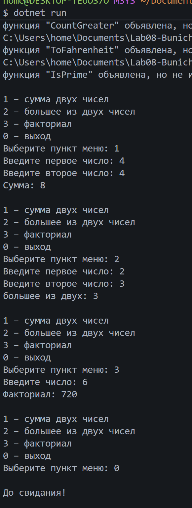
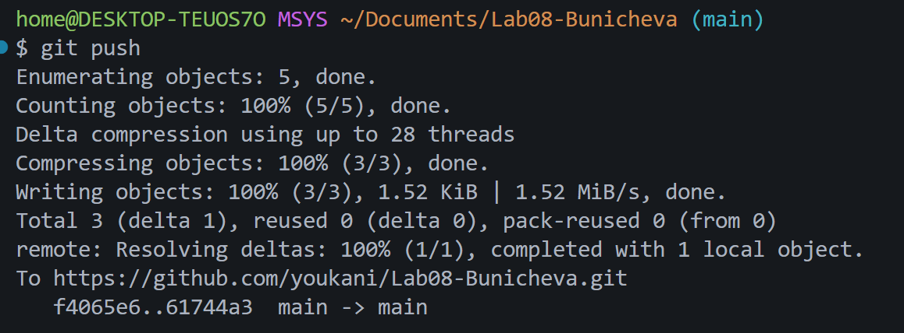

# Практическая работа №8

**ФИО:** Буничева Алёна Алексеевна
**Группа:** ИСП-242
**Дата:** 17.10.2026

## Что изучено
- Научилась разделять код на именованные логические блоки, которые можно использовать повторно.
- Поняла, что `void`-методы просто выполняют действия и ничего не отдают, а методы с типом данных обязаны вернуть конкретное значение через `return`.
- Изучила, как передавать входные данные в методы (включая массивы) для вычислений.

## Скриншоты

